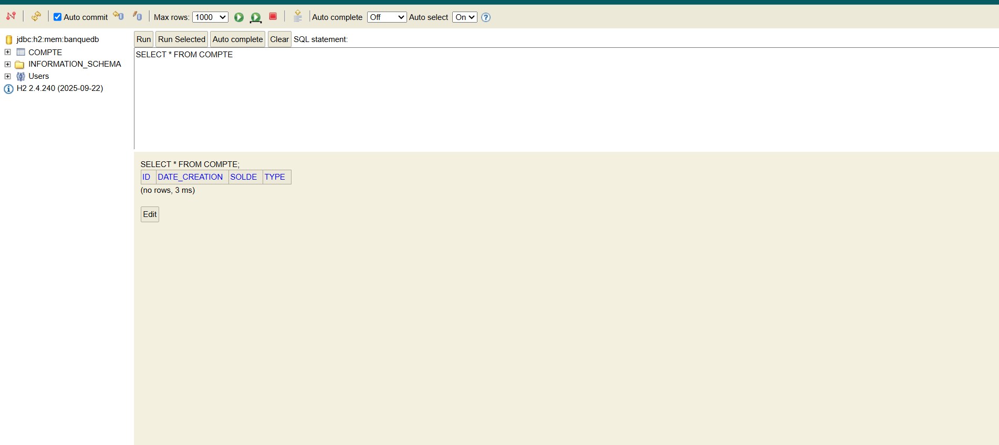

Banque REST API

Description

Ce projet consiste à développer une API REST de gestion des comptes bancaires avec Spring Boot.

L'application permet de créer, consulter et supprimer des comptes bancaires. Les données sont gérées avec Spring Data JPA et stockées dans une base de données H2 en mémoire.

Technologies utilisées

Java 25

Spring Boot

Spring Web MVC

Spring Data JPA

Hibernate

H2 Database

Maven

Lombok

Architecture du projet

src/main/java/com/example/banquerest/
│
├── entities/
│   ├── Compte.java
│   └── TypeCompte.java
│
├── repositories/
│   └── CompteRepository.java
│
├── services/
│   └── CompteService.java
│
├── controllers/
│   └── CompteController.java
│
└── BanqueRestApplication.java

capture:

